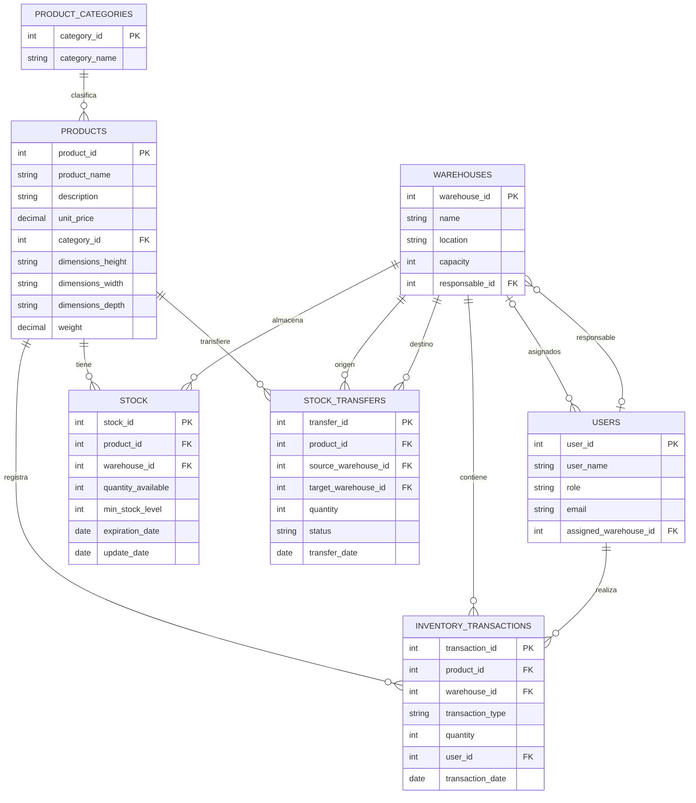

# Modelo Entidad-Relación (MER)

## Módulo de Logística e Inventario

El siguiente diagrama representa las siete entidades del módulo, sus atributos y las relaciones entre ellas.

## Restricciones adicionales

- `PRODUCTS.category_id` es obligatorio (cada producto debe pertenecer a una categoría existente).
- En `STOCK`, la combinación (`product_id`, `warehouse_id`) debe ser única; solo puede existir un registro por producto y bodega.
- `INVENTORY_TRANSACTIONS.transaction_type` solo admite los valores "entrada" o "salida".
- `STOCK_TRANSFERS.status` solo admite los valores "pendiente", "confirmada" o "cancelada".

## Referencia visual

El MER original elaborado por nuestro grupo se conserva como referencia visual.

