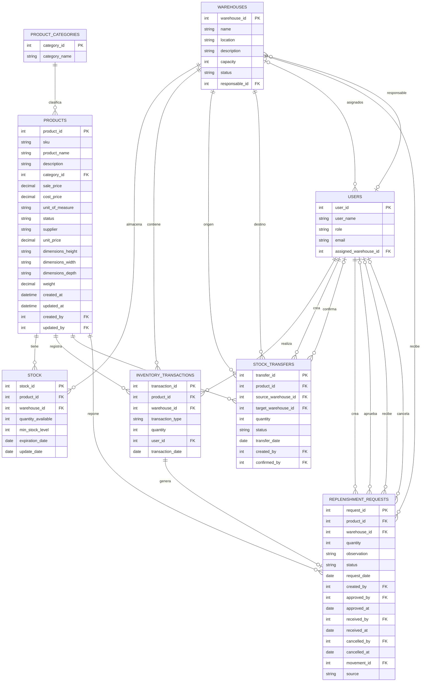

# Modelo Entidad-Relación (MER)

## Módulo de Logística e Inventario

El siguiente diagrama representa las ocho entidades del módulo, sus atributos y las relaciones entre ellas.

## Restricciones adicionales

- `PRODUCTS.category_id` es obligatorio (cada producto debe pertenecer a una categoría existente).
- `PRODUCTS.sku` es obligatorio y único.
- `WAREHOUSES.name` es obligatorio y único.
- `WAREHOUSES.status` solo admite los valores "activo" o "inactivo".
- En `STOCK`, la combinación (`product_id`, `warehouse_id`) debe ser única; solo puede existir un registro por producto y bodega.
- `INVENTORY_TRANSACTIONS.transaction_type` solo admite los valores "entrada", "salida", "ajuste_entrada" o "ajuste_salida".
- `STOCK_TRANSFERS.status` solo admite los valores "pendiente", "confirmada" o "cancelada".
- `STOCK_TRANSFERS.created_by` es obligatorio y registra al usuario que crea la solicitud.
- `STOCK_TRANSFERS.confirmed_by` es obligatorio cuando la transferencia pasa a estado "confirmada".
- `PRODUCTS.unit_price` se conserva solo por compatibilidad con la plantilla base; las reglas de negocio usan `sale_price` y `cost_price`.
- `STOCK.min_stock_level` se configura por producto y bodega y genera alertas cuando `quantity_available` es menor o igual al mínimo (con mínimo mayor que cero); `STOCK.expiration_date` queda reservado para una iteración futura de vencimientos.
- `WAREHOUSES.responsable_id` identifica al responsable principal de la bodega; `USERS.assigned_warehouse_id` identifica la bodega operativa asignada al usuario.
- `REPLENISHMENT_REQUESTS.status` solo admite los valores "pendiente", "aprobada", "recibida" o "cancelada".
- `REPLENISHMENT_REQUESTS.quantity` debe ser un entero mayor que cero y la bodega debe estar activa al crear la solicitud.
- `REPLENISHMENT_REQUESTS.movement_id` se asigna solo al recibir; apunta a un movimiento de entrada inmutable de `INVENTORY_TRANSACTIONS`.
- Solo se aprueban solicitudes pendientes; solo se cancelan solicitudes pendientes o aprobadas; solo se reciben solicitudes aprobadas.
- `recibida` y `cancelada` son estados terminales: no se aprueban, cancelan ni reciben nuevamente.

## Referencia visual

El MER original elaborado por nuestro grupo se conserva como referencia visual.

